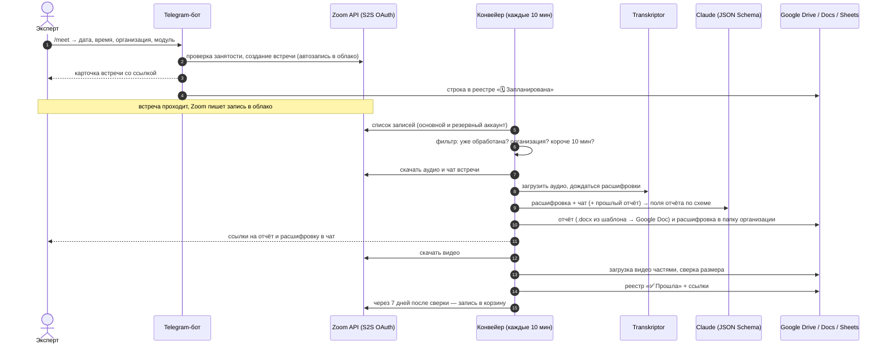

# Бот отчётов экспертов: Zoom → расшифровка → отчёт в Google Docs

Telegram-бот для рабочей группы экспертов. Эксперт в пару нажатий создаёт встречу Zoom прямо из чата, а после встречи бот сам забирает запись из облака, расшифровывает её, пишет черновик отчёта эксперта по утверждённой форме в Google Docs, переносит видео на Google Диск и ведёт общий реестр встреч в Google-таблице. Эксперту остаётся открыть ссылку из чата, проверить черновик и дописать своё суждение.

Работает в продакшене: Python 3.12, служба systemd на VPS, ~2,6 тыс. строк кода.

## Задача

Программа сопровождения НКО: эксперты проводят десятки консультаций с организациями, по каждой нужен отчёт по единой форме и видео в реестре. Вручную это выглядело так: завести встречу в Zoom и разослать ссылку, после встречи скачать запись, отдать на расшифровку, прослушать или перечитать её и написать отчёт, загрузить видео в нужную папку, внести строку в реестр, а потом не забыть почистить облако Zoom, чтобы не кончилось место. Отчёты задерживались, папки и реестр расходились с реальностью.

## Что изменилось для пользователей

- **Эксперт** больше не занимается ни организацией встречи, ни расшифровкой, ни выкладкой файлов: создаёт встречу командой `/meet`, а после встречи получает в чат ссылки на готовый черновик отчёта, расшифровку и видео. Отчёт начинается не с чистого листа, а с текста по форме, где уже есть решения, договорённости с именами и сроками и риски.
- **Руководитель программы** видит в одной таблице все встречи со статусами (запланирована → прошла → отчёт готов / записи нет / отменена) и ссылками на отчёт, расшифровку, видео и запись Zoom.
- **Администратор аккаунта Zoom** не следит за местом в облаке: записи уходят в корзину сами, но только после того, как видео гарантированно лежит на Диске.

## Возможности

- **Мастер `/meet`** прямо в групповом чате: дата → время (МСК) → длительность → организация → модуль → номер встречи → подтверждение. Проверка занятости слота, кнопки на ближайшие две недели и ручной ввод (`25.09`, `завтра`, `15.30`, `1,5 ч`). Несколько человек могут оформлять встречи одновременно, чужие кнопки не срабатывают.
- **Карточка встречи** со ссылкой и кодом доступа, кнопки «Изменить» и «Удалить»; `/mymeetings` — свои встречи (администраторам группы — все). Ссылка организатора (`start_url`) в чат не попадает.
- **Встречи-продолжения**: если модуль и номер встречи повторяются, бот спрашивает «это продолжение?» и передаёт модели отчёт прошлой встречи, чтобы она написала, что добавилось и что так и осталось незакрытым.
- **Автоматическая обработка каждые 10 минут**: запись Zoom → Transkriptor → Claude → отчёт по шаблону `.docx` → Google Docs в папке организации → ссылка в чат.
- **Видео на Google Диск** с возобновляемой загрузкой и сверкой размера; через 7 дней после проверенной загрузки запись уходит в корзину Zoom.
- **Свои записи экспертов** (`/upload`): если встреча прошла не в Zoom, бот создаёт папку на Диске, эксперт кладёт туда аудио или видео (можно несколько частей), и бот делает по ним один отчёт.
- **Общие встречи программы** (мастер-майнды): только расшифровка и видео, без отчёта эксперта.
- **Резервный аккаунт Zoom**: если на основном время занято, бот предлагает поставить встречу на второй аккаунт; записи забираются с обоих.
- **Реестр встреч** в Google-таблице: создаётся и оформляется автоматически, при добавлении столбцов переписывается сам.
- Служебные команды: `/process` — запустить обработку вручную, `/chatid` — узнать id группы, `/cancel`, `/help`.

## Как устроен конвейер



## Стек

- **Python 3.12**, `asyncio`
- **python-telegram-bot 20+** — мастера на inline-кнопках, фоновая задача конвейера
- **Zoom REST API** — Server-to-Server OAuth, встречи и облачные записи (`httpx`)
- **Transkriptor API** — расшифровка русской речи (`requests`)
- **Anthropic API (Claude)** — структурированный ответ по JSON Schema
- **python-docx** — заполнение фирменного шаблона отчёта с сохранением оформления
- **Google Drive / Docs / Sheets API** — папки организаций, конвертация в Google Docs, реестр
- **systemd** на VPS, выкатка архивом по ssh

## Инженерные решения

- **Zoom Server-to-Server OAuth** (`zoom_client.py`): токен по `account_credentials` кэшируется в памяти отдельно для каждого аккаунта и обновляется за минуту до истечения. Поддержаны два аккаунта: сбой резервного не мешает работе основного.
- **Идемпотентная обработка** (`storage.py`, `pipeline.py`): состояние каждой записи по её `uuid` хранится в `data/processed.json` (`done` / `skipped` / `failed`, число попыток, ссылки). Ссылки на загруженные документы сохраняются сразу после каждой загрузки, поэтому повтор после сбоя не плодит дубли на Диске. Запись JSON — атомарная (временный файл + `os.replace`) под блокировкой; повторный запуск цикла, пока идёт предыдущий, отсекается `asyncio.Lock`.
- **Структурированный ответ модели** (`report_writer.py`): Claude отвечает строго по JSON Schema (`output_config.format = json_schema`, `additionalProperties: false`), поэтому каждое поле сразу ложится в свой раздел шаблона. Обрабатываются `refusal` и `max_tokens`, включён серверный fallback на запасную модель. В промпте — запрет выдумывать: если по разделу в записи ничего нет, пишется «В записи не прозвучало».
- **Политика хранения записей**: запись удаляется из облака Zoom (в корзину, не безвозвратно) только через `ZOOM_TRASH_AFTER_DAYS` дней и только если видео на Диске проверено. Для резервного аккаунта удаление отдельно выключено по умолчанию.
- **Сверка размера видео**: загрузка на Диск идёт частями по 16 МБ с повторами (`resumable`), и запись считается перенесённой, только если размер файла на Диске совпадает с размером в Zoom байт в байт.
- **Защита от ложных отчётов**: записи короче `MIN_RECORDING_MIN` (участник зашёл заранее и вышел) и записи до `PROCESS_SINCE` пропускаются; встречи без организации в названии не трогаются.
- **Обработка ошибок**: до 3 попыток на запись и на видео, после этого — понятное сообщение в чат, а запись остаётся в облаке Zoom. Сбой реестра никогда не ломает отчёты: обновление реестра изолировано. Временные файлы удаляются в `finally`.
- **Реестр без дрейфа** (`registry.py`): строка каждой встречи всегда собирается целиком из локального состояния, поэтому синхронизацию можно запускать сколько угодно раз; при изменении набора столбцов таблица мигрирует сама.
- **Доступ и безопасность**: бот работает только в группах из `ALLOWED_CHAT_IDS`, ссылка организатора не публикуется, все ключи — в `.env`, токен Google — в отдельном файле с правами `600`.
- **Эксплуатация**: служба systemd с `Restart=always`, выкатка одной командой (`deploy/deploy.sh`), рабочее состояние `data/` на сервере не перезаписывается.

## Структура

| Файл | Что делает |
|---|---|
| `bot.py` | Мастера `/meet` и `/upload`, карточки встреч, `/mymeetings`, `/process`, `/chatid`, запуск фонового конвейера |
| `zoom_client.py` | Zoom API: OAuth, встречи, записи, скачивание, корзина |
| `pipeline.py` | Конвейер обработки записей, видео и своих записей экспертов |
| `transcriber.py` | Клиент Transkriptor |
| `report_writer.py` | Промпт, JSON Schema и заполнение шаблона `templates/report_template.docx` |
| `gdrive.py` | Google Drive / Docs: папки, загрузка, конвертация |
| `registry.py` | Реестр встреч в Google Sheets |
| `storage.py` | Состояние в JSON-файлах `data/*.json` |
| `config.py` | Все настройки из `.env` |
| `deploy/` | Unit systemd и скрипт выкатки |

## Как запустить

1. **Zoom**: в marketplace.zoom.us создайте приложение Server-to-Server OAuth, скопируйте Account ID, Client ID и Client Secret. Права: создание, изменение и удаление встреч, список встреч, чтение и удаление облачных записей. Для облачной записи нужен платный тариф.
2. **Telegram**: получите токен у @BotFather, добавьте бота в группу, напишите `/chatid` и впишите id в `ALLOWED_CHAT_IDS`.
3. **Google**: создайте OAuth-клиент, получите `google_token.json` с `refresh_token` (доступ к Drive и Sheets) и укажите ID общей папки в `GOOGLE_DRIVE_ROOT_ID`.
4. **Ключи** Transkriptor и Anthropic — в `.env`.

```bash
cp .env.example .env          # заполнить
python3.12 -m venv venv && source venv/bin/activate
pip install -r requirements.txt
python bot.py
```

Боевой режим — на сервере как служба systemd:

```bash
sudo cp deploy/zoom-expert-report-bot.service /etc/systemd/system/
sudo systemctl enable --now zoom-expert-report-bot
DEPLOY_HOST=user@your-server.example.com ./deploy/deploy.sh   # последующие выкатки
```

Важно: запускайте только один экземпляр бота на токен, иначе экземпляры будут делить между собой сообщения.

---

Опубликовано в обезличенном виде: удалены данные программы, ключи и адреса серверов.
